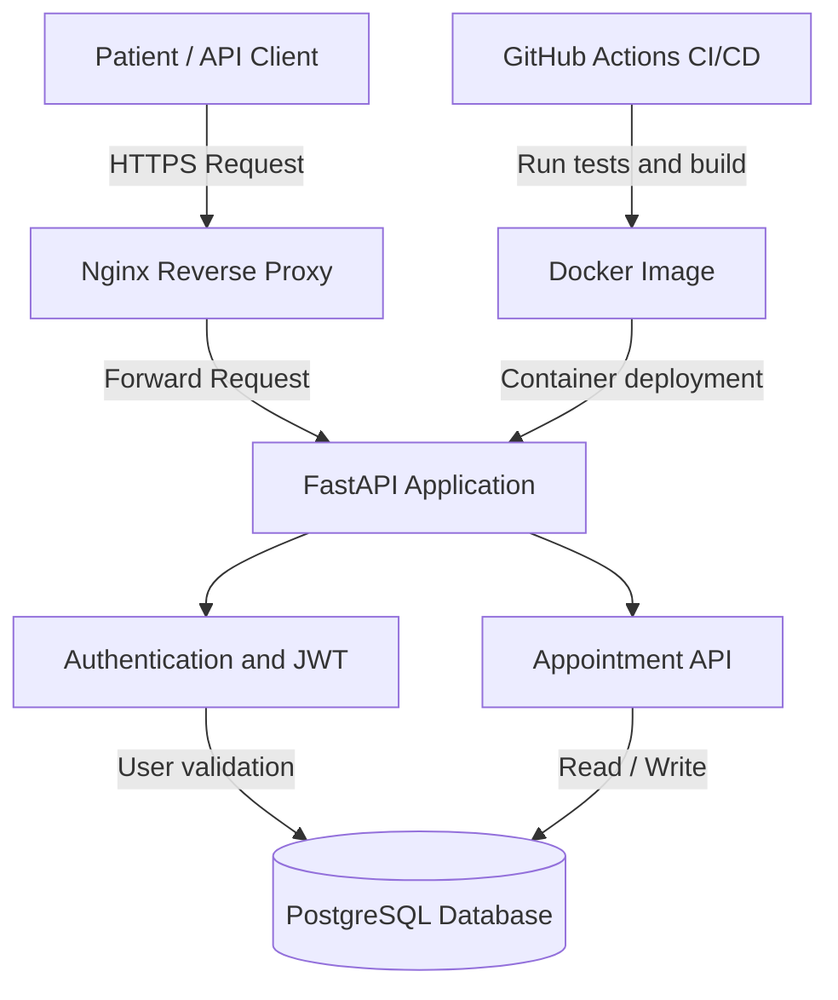

# Hospital Appointment API – System Architecture

## 1. Architecture Overview

The system uses a containerized architecture consisting of an Nginx reverse proxy, FastAPI application, and PostgreSQL database.

## 2. Architecture Diagram

## 3. Main Components

### Nginx Reverse Proxy
- Receives incoming client requests.
- Forwards requests to the FastAPI application.
- Handles the configured HTTPS redirect and TLS termination.

### FastAPI Application
- Provides REST API endpoints.
- Handles patient registration and login.
- Manages doctor appointment operations.
- Validates incoming requests.

### Authentication Module
- Uses JWT bearer tokens.
- Verifies user identity.
- Enforces patient access restrictions.

### PostgreSQL Database
- Stores patient information.
- Stores doctor information.
- Stores appointment records.
- Stores audit events.
- Uses a persistent Docker volume.

### GitHub Actions
- Runs automated tests.
- Checks Python syntax.
- Builds the Docker image when code is pushed or a pull request is opened.

## 4. Deployment Architecture

The application is deployed using Docker Compose.

The deployment contains three main containers:

1. `hospital_nginx` – Reverse proxy.
2. `hospital_api` – FastAPI application.
3. `hospital_db` – PostgreSQL database.

The containers communicate through a dedicated Docker bridge network.

## 5. Data Flow

1. A patient sends a request to the application.
2. Nginx receives the request and forwards it to FastAPI.
3. FastAPI validates authentication where required.
4. The API processes the requested operation.
5. PostgreSQL stores or retrieves the required information.
6. FastAPI returns the response through Nginx.
